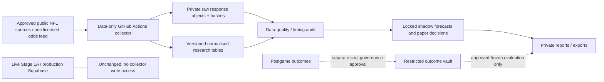

# Prospective NFL evidence capture and paper validation — proposal only

Prepared 2026-11-14. **No implementation or activation is authorised by this document.** No workflow, table, secret, subscription, dashboard or production setting has been created or changed. Stage 1C.2 Stage 2 fitting remains prohibited. The recommendation is to improve evidence collection first, with no new model complexity.

PR #7 was merged for research-only retention at `ad6b545e2a0e132d336806aa56a99fbee0e9cd04`. Its tree matches the approved head exactly. Final-head and post-merge CI passed; the local production app/bundle check retained nine models, 780 slate rows and 18 Top Picks. Stage 1A release `stage1a-20261113-py314-arrow24-r2`, original probabilities, Supabase, authentication, bankroll/settings and all frozen research benchmarks remain unchanged. The authenticated live view was not independently accessed.

## Recommended minimum solution

Use a dedicated **data-only GitHub Actions collector**, a **separate private Supabase research project** and **one authorised odds feed**. Retain Streamlit Community Cloud and Python 3.14 / PyArrow 24.0.0. Keep the production app and betting ledger unchanged; use private CSV/HTML exports for the initial research review, not a new hosted dashboard.

Start with a small manual Bet365 UK quote sample and free public NFL source checks. Buy an API plan only after an actual NFL coverage/licence test passes. Do not purchase historical odds initially: prospectively archived quotes are the evidence we lack, and buying a large backfill is not the first priority.

The proposed first spending ceiling is **$50/month for odds, $0–25/month for isolated research storage**, before tax/FX. This is a budget limit for approval, **not a verified vendor quotation**. If no legally usable UK NFL feed fits the cap, retain the manual pilot and return with alternatives. Do not substitute US odds or incomplete markets while claiming Bet365 UK coverage.

## 1. Evidence sources and capture design

| Information | Preferred initial source | Timing and limits | Proposed fallback |
| --- | --- | --- | --- |
| Fixtures and kickoff changes | nflverse schedules | Official nflreadr schedule documentation describes five-minute season updates; measure actual delay and re-check fixture IDs/kickoffs | Official NFL fixture source, manually reviewed discrepancies |
| Team membership, status, transactions | Versioned nflverse roster snapshots, plus official NFL/team transaction notices where permitted | nflverse documents daily 07:00 UTC roster updates. This is not a final game-day active list. Preserve every observed version; do not overwrite last week's membership | Official dated team notices; unknown/unassigned state when evidence is missing |
| Injury reports | nflverse injury snapshots plus official team/NFL reports | Documentation describes daily 07:00 UTC updates. The inspected 2025–26 injury schema lacks date_modified. Capture receipt time; do not manufacture publisher timestamps | Dated official report/link captured before the decision; mark freshness/coverage failures |
| Final inactives | Official team/NFL announcements, commonly around 90 minutes before kickoff, where an authorised machine-readable source exists | No reliable free complete T−60 feed has yet been verified. A daily roster feed is insufficient. Confirm source rights, update cadence and completeness in the pilot | Small manual archive of the official list, server timestamped before cutoff; otherwise status remains unknown |
| Actual participation and prior usage | nflverse/PFR snap counts and published box/PBP records **after** games become available | Snap update schedule is documented as 00/06/12/18 UTC, dependent on PFR availability. Store actual receipt/version. Do not treat these as current-game pregame inputs | Official gamebook/box record and manual review of identity/credit conflicts |
| Detailed participation/coverage | Not an initial feature source | nflreadr explicitly says its 2023-onward FTN participation is released after the postseason. Exclude it as in-season evidence | No guessed route/scheme/participation substitute |

The documented update schedules are upstream targets, not our observation of a service-level guarantee. Monitor actual freshness; source outages or delayed status changes must produce an explicit gap, not a healthy/active/zero default. Named statuses such as ACT/INA/TRC/TRD must be interpreted by source and version; non-ACT does not universally mean inactive.

Capture the raw response before normalisation. For each acquisition retain:

- Source/provider, canonical credential-free endpoint, event/player/vendor IDs and requested scope.
- Source event/effective time, original publication/modification time **if supplied**, provider last_update and source version/ETag.
- Request start, response received, private archive committed and server-insert timestamps in UTC, plus GitHub run ID and request latency.
- Raw-body SHA-256, compressed private object path, parser/schema version, source/licence version and quality flags.

Keep publication, effective and observation times distinct. A later correction has a new observation/version; it never overwrites the earlier snapshot. If the source supplies no publication time, store null. A raw snapshot demonstrably received and archived before the cutoff can establish **observed-before-decision** evidence; it does not establish an earlier original publication date. This proposed prospective contract needs approval and does not relax the frozen historical verifiers or relabel their unknown timestamps.

A typical candidate schedule is daily roster/injury capture, additional checks on practice/report days, then fixture-relative observations around T−24h, T−180, T−90, T−65 and T−61. Finalise the decision record **before T−60**. Closing observations around T−10 and T−2 are strictly diagnostic and cannot enter the T−60 decision. Exact cadence, freshness limits and source permissions are frozen after a short no-bet technical pilot and before outcome review.

No bot should bypass authentication, CAPTCHAs, access controls or source restrictions. For official pages without an authorised automation interface, retain manual evidence or seek an appropriate licensed feed. A fully automatic, free, complete inactive-status service is **not** a confirmed deliverable today.

## 2. Odds providers: UK suitability before price

| Option | Evidence available in this review | What must pass before use | Cost status |
| --- | --- | --- | --- |
| Manual Bet365 UK observations | Directly matches the user's intended market when observed in their own UK interface | Main line, both prices where available, timestamped evidence, market/void/OT rules; no account credentials stored | $0 data-subscription cost; limited volume and manual effort; source-use terms still apply |
| **Odds-API.io — Bet365 trial priority** | Its official Python SDK explicitly illustrates Bet365, advertises player props/history/closing/settlement, and says an API key requires a paid monthly plan | Actual **NFL × Bet365 UK × each required prop**; jurisdiction, freshness, player IDs, both sides and archive rights. A football example is not proof of NFL props | Current plan price and entitlements unverified: official pricing site blocked. Obtain a sample/quote before any paid trial |
| **The Odds API — integration-first alternative** | Existing frozen research capture helper targets seven NFL prop keys and us,uk regions; official sample client is available | A UK-accessible bookmaker with the required NFL props. Bet365 coverage and UK prop entitlement were not verified. Do not assume a UK region parameter proves UK prop availability | Current prices/free allowance/history entitlement unverified; check official plan and measured request cost |
| SportsGameOdds — alternative shortlist | Official SDK and player-props example advertise NFL props and an available free API key | UK bookmaker/jurisdiction coverage, all requested categories, timestamps, retention rights and actual free/paid entitlements. Free key does not prove free full NFL props | Current numeric tariffs unverified; obtain plan detail before purchase |
| OpticOdds / SportsDataIO or another licensed commercial feed | Potential routes for broader odds/status coverage; not validated as the inexpensive answer in this review | Written NFL/UK/Bet365-specific coverage and retention/settlement terms | Treat as quote-dependent alternatives, not included in the proposed budget or recommended purchase |

**Recommendation:** prioritise an Odds-API.io Bet365-specific sample because its first-party SDK explicitly names Bet365. Prefer the existing The Odds API integration if a genuine comparable UK bookmaker passes the same trial at a lower total cost. No provider has yet been demonstrated here to deliver all required Bet365 UK NFL markets cheaply. The vendor must prove that combination, not just list a bookmaker logo.

Coverage acceptance uses real pregame examples from at least two fixtures, then one full NFL weekend before scaling. Compare with user-observed UK prices, including representative quarterbacks, RBs, WRs and TEs. Check all nine model markets: passing yards/attempts/completions; rushing yards/attempts; QB rushing yards/attempts; receiving yards/receptions. QB rushing normally maps to the same two provider markets as other rushing, yielding **seven canonical market types**, with player position validated separately. Store event, player, line, period, OT inclusion, side and jurisdiction together. Exclude unsupported/ambiguous variants; never fabricate their prices.

UK brands to request sample coverage for include Sky Bet, William Hill, Paddy Power and Betfair Sportsbook. This is a verification shortlist, not a confirmed provider-supported NFL prop list; Betfair Exchange is a different product with commission/liquidity considerations.

Begin with main lines and one primary bookmaker. If only some categories are genuinely available, publish the missing-market coverage explicitly while retaining all nine forecast series. Avoid a multi-provider, exchange or streaming integration until the basic archive is reliable. An exchange back/lay price, commission-adjusted price or US bookmaker variant cannot silently stand in for a UK sportsbook quote.

### Request budget example, not a tariff quotation

For 16 games/week, four weeks and six odds observations per game: **384 event snapshots/month**. Under a tariff charging one credit per requested market and region, seven markets and one region imply **2,688 credits/month**, or about 3,360 with 25% headroom. Two charged regions would double that component. Actual billing, empty-market charges, bookmaker filters and history/add-ons must be verified from the chosen vendor's contract and quota headers. Do not compare one vendor's requests with another's credits as if they were the same unit.

The existing stage1b1 odds helper defaults to us,uk and is a frozen benchmark source. It is **not activated or edited**. A future adapter belongs in a new namespace with one approved region/bookmaker, explicit cost accounting and a hard stop before quota/spend limits. Never persist an API key in request URLs, raw payloads, Git history or logs.

## 3. Collection and historical storage architecture

Prefer a **separate research Supabase project**, with its own private bucket and credentials. Do not put these records in the existing bets or settings tables, and do not pass production Supabase credentials to the collector. This isolates research storage errors, settlement and paper stakes from the real ledger/bankroll. If project limits prevent this, return for approval of an alternative; do not silently use the production project.

Conceptual tables (design only; no SQL/migrations created):

| Object | Purpose |
| --- | --- |
| capture_runs / source_snapshots | Requests, failures, source/receipt/archive timestamps, raw hashes/paths and parser/licence versions |
| fixtures / identity_versions | Kickoff revisions and time-bounded team/player/provider mapping with unresolved/conflict states |
| roster_status_versions | Append-only observed membership, injury and inactive assertions tied to source evidence |
| odds_quotes | Provider and bookmaker/jurisdiction, player/market/period/line/side/price, freshness, observed availability and rule version |
| forecast_snapshots | Immutable release/model/code/data/feature hashes, training cutoff, forecast time, projection and original pricing-method version |
| paper_decisions | All priced candidates, explicit selections/rejections, quote/rule/forecast IDs, probabilities, estimated EV and fixed paper units |
| closing_observations | Later pre-kickoff same-contract quotes, age, same-book/benchmark distinction and CLV eligibility |
| settlement_events | Append-only proposed/final/corrected grades, result evidence and refund accounting; restricted by the seal |
| quality_events / protocol_versions | Missing feeds, stale/late observations, mapping conflicts, missed deadlines and signed-off policy versions |

Raw objects are compressed JSON/HTML/PDF bytes in private Storage; normalised query fields stay in Postgres. Partition/index by event and capture date. Use inserts, unique idempotency keys and no overwrite/upsert of historical versions. Make raw-object completion and hash checks prerequisites for admitting an evidence row. Restrict ingestion permissions/RPCs and researcher access; use a separate outcome writer if blind settlement is eventually approved.

These controls are tamper-evident, not absolute WORM: an administrator can still alter a normal database. Retain daily manifest roots and regular independent private exports/backups, with restore tests. Hashes alone do not prove when a quote was available. Use server-receipt/run evidence and actual timestamps, never user-entered backdating. Retention must comply with the provider licence.

GitHub Actions should have read-only repository permissions and no ability to select a release, train, push commits or invoke the legacy updater. Polling does not produce code commits or Streamlit redeployments. After a later implementation approval, start with manual dispatch/dry runs; scheduled activation is a separate reviewed action. Secrets are entered by the owner into the approved research secret store, not supplied in chat.

A low-cost scheduler can wake outside the top of the hour, group games sharing kickoff windows and start a bounded worker early enough to poll near the decision/closing windows. GitHub documents that scheduled jobs can be delayed or dropped; there is **no exact T−60 SLA**. Late decisions must be rejected, not backdated. Capture failures and missed fixtures remain in the denominator. If persistent timing gaps occur, propose a small managed worker only after measuring the problem and obtaining a cost approval; do not add infrastructure prematurely.

Streamlit is a viewer, not the scheduler or durable raw store. Its process can sleep/restart and local files are temporary. Initially use private exports rather than adding a production page or hosting a research dashboard.

## 4. Paper-betting protocol

The initial shadow baseline is the **unchanged Stage 1A forecasting/pricing method**, with explicit release/model/source hashes. Do not activate Stage 1B/1B.1/1C experimental probabilities or fit Stage 1C.2 allocation models. All earlier benchmarks remain frozen. A future challenger would need its own advance approval and protocol, not retrospective selection from these results.

A static existing release cannot be assumed valid for every future fixture. Before any paper run, validate fixture coverage, completed-game cutoff, model age and feature availability. If a valid forecast cannot be produced under the approved frozen method and seal rules, record a missing forecast. Do not reuse the previous game's projection, extend an activation deadline, change production releases or retrain without approval.

For each candidate, lock before T−60:

- Actual forecast/decision timestamps, target cutoff and source evidence available by that moment.
- Event/player/position, bookmaker and UK jurisdiction, main/alternate status, line, side, decimal price, period/OT and settlement-rule snapshot.
- Point forecast, supplied model probability, pricing method/version, calibration status and source freshness/availability flags.
- Quoted implied probability, two-sided margin where both sides match, estimated EV, selection/rejection reason and **one paper unit** if selected. Real stake is always zero; no live bankroll/settings write.

Record all eligible candidates and all rejected/missing cases, not just attractive bets. A proposed simple selection rule is one primary bookmaker, main lines only, one selected side per player/market/game, fixed 1-unit stake and at least 3% estimated EV; this is a policy for approval before outcomes, not an assertion that the probabilities are profitable. Do not use an unsupported confidence score or fractional Kelly initially. No parlays or automatic real wagering.

For an action-valid outcome partition, `EV/unit = p_win × (decimal_odds − 1) − p_loss`, with pushes/voids refunded. The original Stage 1A normal-pricing method does **not** explicitly model integer-line push mass or inactive/void probability. Therefore start EV-based selection on half-integer lines only, and label probabilities/EV as conditional on the market having action. Archive integer-line quotes but exclude them from primary EV selection until a separately approved push-aware method exists. Do not silently alter live pricing or imply an unconditional EV when void probabilities are unknown. Margin is already embedded in the offered odds; do not subtract it twice. A no-vig market probability is a comparison, not ground truth.

Closing observations must match the **same bookmaker/jurisdiction, player, side, period, rule and original line**. If an original 49.5 line is replaced by 59.5, those odds are not directly comparable. Log directional line movement in stat units separately. Where both closing sides exist at the same line, report a clearly labelled no-vig price comparison; for half-lines a useful measure is `p_close_no_vig × entry_decimal_odds − 1`. Also report simple same-contract price CLV if desired, distinctly labelled. Closing margin removal is an estimate, not certainty.

The last valid observation before kickoff is a **sampled closing proxy**, with its age recorded. A missing or stale same-contract close remains missing; do not use a post-kickoff/in-play price or invent an intermediate line price. Vendor-supplied historical closes, if licensed later, are a separate evidence tier. Feed availability is not proof that a stake could have been executed in the user's account; mark every record paper/unexecuted.

Settlement, only after explicit seal-governance permission, uses archived market-specific rules and authoritative result/participation evidence: win, loss, push, void, postponed/abandoned and pending. A player can have zero opportunities while the bet has action; inactivity, no offensive snap and a void are different questions governed by that bookmaker's rule. Preserve original decisions and append stat/grade corrections with versions. One unit returns D on a win, 0 on a loss and 1 on a push/void. Report profit divided by declared stake denominators, separately showing all selections, actioned stake, refunds and pending cases. Missing/ambiguous settlement stays pending.

Later authorised evaluation should report forecast accuracy and bias for all nine markets, Brier/log loss/reliability, sample sizes, selection/quote coverage, paper ROI and CLV separately, with uncertainty clustered by game/week. Repeated lines and correlated player props are not independent bets. Lock the policy/model before the cohort; do not tune on an apparent profitable subgroup. Neither positive CLV nor a short winning run proves a sustainable edge.

## 5. The sealed final period is a real gate

The existing seal covers 2026 week 11 onward **and later seasons**. Moving to next season or renaming a cohort does not put it outside that seal. No current historical verifier, runner or source filter will be weakened.

Before implementing a prospective collector/paper runner, approve an explicit policy for what future input snapshots may be blindly archived and whether any sealed postgame data may be stored in an isolated restricted vault. This proposal does **not** authorise reading/materialising sealed outcomes, even for settlement. If an outcome vault is approved later, ordinary research readers and report jobs must not have access; settlement must not expose results as a backdoor evaluation.

No prospective ROI, calibration or result review is possible under the current unchanged all-future seal without a separately approved review/unsealing policy. The safest direction is advance registration of frozen shadow decisions, blind accumulation where explicitly permitted, and a later owner-authorised fixed evaluation. Do not fit, select methods, inspect sealed losses/wins or feed sealed outcomes into rolling feature updates by an alternative route. Training/feature refresh permissions must be addressed explicitly as part of that governance, not assumed.

Capture-only technical checks (timestamps, coverage, missingness, parsing and source rights) can be planned independently of performance review, but their actual activation still needs approval. The frozen Stage 1B.1 probability methodology and Stage 1C.2 2%/paired/season/coherence/all-market safeguards remain unchanged if modelling is ever resumed.

## 6. Costs, capacity, phases and approvals

Costs below are incremental research estimates in USD, excluding VAT, FX and any existing production charges. Official vendor pricing pages were blocked in this environment; first-party GitHub material could be inspected. **No subscription was bought and no API key was requested.**

| Component | Verified information / assumption | Practical budget |
| --- | --- | --- |
| Public-source/manual pilot | No paid data feed; source-use terms and manual effort still matter | $0 subscription cost |
| GitHub Actions | Current model repository is public. GitHub documents standard hosted runners as free for public repositories; specialised runner/storage products differ | Target $0 compute; do not archive licensed raw data publicly or rely on expiring Actions artifacts |
| Isolated Supabase Free | Official pricing source lists $0, 500 MB database, 1 GB file storage, 5 GB egress, two active projects and pausing after one week inactive | $0 if account/project capacity allows; not a guaranteed always-on archival service |
| Isolated Supabase Pro | Official pricing source lists from $25/month including one Micro project; additional projects/compute can add cost | From $25/month only with approval; preferable for continuous reliability once the pilot is worthwhile |
| One licensed odds feed | Numeric current price/UK NFL entitlement not verified | Proposed cap $50/month, not a vendor offer. If no suitable plan fits, retain manual capture or return for revised approval |
| Combined automatic pilot | Suitable approved feed price X plus research storage | X + $0, or X + $25 base; proposed initial total ceiling $75/month, subject to verified quotes/tax |
| Enterprise statuses/odds, extra worker, historical backfill | Not required for the initial plan and no usable quote verified | $0 allocated; separate approval required |

GitHub's current source documentation expresses private-plan allowances as included compute credits (Free $12/month, about 2,000 standard Linux minutes at the documented $0.006/minute guide rate), rather than a universal free unlimited private runner. If code is moved to a private repo or runner type changes, re-budget it. Scheduled public workflows can also be disabled after 60 days without repository activity. Add a heartbeat/missed-capture alert after approval; do not assume cron is guaranteed.

Illustrative storage sizing: 16 games/week × 100 two-sided player-market contracts/game × 2 sides × 6 snapshots × four weeks = **76,800 quote rows/month**. At roughly 0.6–1.5 KB per row including index overhead, plan around 50–120 MB/month of normalised data, plus raw compressed objects and logs. These are assumptions to measure, not observed usage. Free storage may fill within a season. Keep raw responses compressed, avoid unneeded alt-line/live markets, monitor limits and arrange private exports/approved longer-term storage before exhaustion. Never delete audit evidence silently to stay free. The paid tier's database backup allowance is not a substitute for an independently tested raw-object export.

| Phase | Deliverable and gate | Engineering estimate | Running/data time |
| --- | --- | --- | --- |
| 0 — source, licence and seal decisions | Written coverage/retention terms; Bet365 UK versus comparable book decision; spending cap; prospective/seal policy | 1–2 days | Vendor replies may take longer; no activation |
| 1 — evidence foundation | Proposed separate research store, source contracts, manual dry-run collector, idempotency/hash/replay/late-run tests, no production credentials | 3–5 days after approval | 1 NFL weekend to measure source freshness and inactive gaps |
| 2 — one odds adapter | Trial seven canonical markets against UK examples; rule capture, quota accounting, canonical IDs; accept partial coverage explicitly or reject vendor | 2–3 days; can overlap Phase 1 | At least one representative NFL weekend before scaling |
| 3 — frozen paper decisions | Exact baseline versioning, half-line-only primary EV policy, fixed paper units, closing proxy, restricted settlement design | 2–4 days after explicit governance approval | No result access until the seal policy permits it |
| 4 — operations pilot and review | Two full NFL weekends, coverage/freshness/clock/mapping/restore audit, private exports and cost report | 1–2 days of review | About 2 weekends; not a profitability test |

Allow **roughly 2–3 working weeks of engineering**, then two NFL weekends of operational proving, subject to access/licensing and approvals. This is a planning estimate, not a commitment that free sources will meet every inactive-status deadline. Meaningful prospective performance evidence requires substantially more fixtures—ideally a full-season cohort with market-specific uncertainty—not a promised win rate after a few weeks. No performance-review date can be promised while the existing seal is unchanged.

Proposed launch gates: all schema/hash/cutoff/duplicate/credential-redaction tests pass; every accepted decision archived before T−60; ambiguous identities and stale/missing quotes fail closed; representative UK source checks pass; daily raw/normalised count reconciliation and restore test pass; observed capture success target at least 95% of planned eligible snapshots over two weekends, with every missed fixture reported. This operational 95% target does not prove calibration or profitability. If authoritative inactive coverage is incomplete, report that explicitly and do not advertise a fully automated roster-informed model.

### Decisions requested for a later implementation approval

1. Approve capture-only foundation and an isolated research Supabase project; production app/ledger remain untouched.
2. Choose Bet365 UK as mandatory or accept a specifically verified UK alternative; approve one provider only after its sample/licence/price check.
3. Set the monthly cap (proposed $50 odds / $75 total before tax), retention/backup responsibility and source-access domains.
4. Approve an explicit prospective/sealed-data policy before future forecast/settlement processing or any outcome review. No approval is inferred from this proposal.

Current state: PR #7 retained as authorised; proposal on a documentation-only branch. No new data pipeline, purchase, provider configuration, database migration, fitting, dashboard host, release selection or additional merge has occurred.

## Sources and verification limits

First-party sources inspected through their official GitHub repositories on 2026-11-14:

- [nflreadr data-update schedule](https://github.com/nflverse/nflreadr/blob/main/vignettes/articles/nflverse_data_schedule.Rmd): roster/injury daily cadence, snap/NGS schedules and postseason participation restriction.
- [Odds-API.io official Python SDK](https://github.com/odds-api-io/odds-api-python): Bet365 examples, generic player-prop features, paid-key requirement and plan-dependent entitlements. This is not NFL UK market certification.
- [The Odds API official Python samples](https://github.com/the-odds-api/samples-python) and existing frozen `stage1b1/odds_capture.py`: integration scope only, not current price/UK coverage verification.
- [SportsGameOdds official props example](https://github.com/SportsGameOdds/player-props-analyzer) and [SDK](https://github.com/SportsGameOdds/sports-odds-api-python): advertised NFL prop capability and free-key availability, not complete UK entitlements or a price quote.
- [Supabase official plan data](https://github.com/supabase/supabase/blob/master/packages/shared-data/plans.ts): Free/Pro prices, quotas and pause/project limits; [pricing](https://supabase.com/pricing) must be rechecked before purchase.
- [GitHub official billing documentation source](https://github.com/github/docs/blob/main/content/billing/concepts/product-billing/github-actions.md), [included quotas](https://github.com/github/docs/blob/main/data/reusables/billing/actions-included-quotas.md), [schedule delays](https://github.com/github/docs/blob/main/data/reusables/actions/schedule-delay.md) and [schedule behaviour](https://github.com/github/docs/blob/main/content/actions/reference/workflows-and-actions/events-that-trigger-workflows.md).

Blocked official pages include [The Odds API pricing](https://the-odds-api.com/), [Odds-API.io pricing](https://odds-api.io/pricing), [SportsGameOdds pricing](https://sportsgameodds.com/pricing/) and [OpticOdds pricing](https://opticodds.com/pricing). Access has been requested for the first two plus Supabase/GitHub documentation. Do not interpret blocked access as evidence of zero cost or absent product coverage. The companion source inventory records successful retrieval hashes and blocked checks. Vendor examples and SDK software licences do not grant an odds-data archival/redistribution licence. Require explicit permission for private historical retention, derived metrics and any later display; no public quote redistribution, account scraping or provider selection is approved here.
