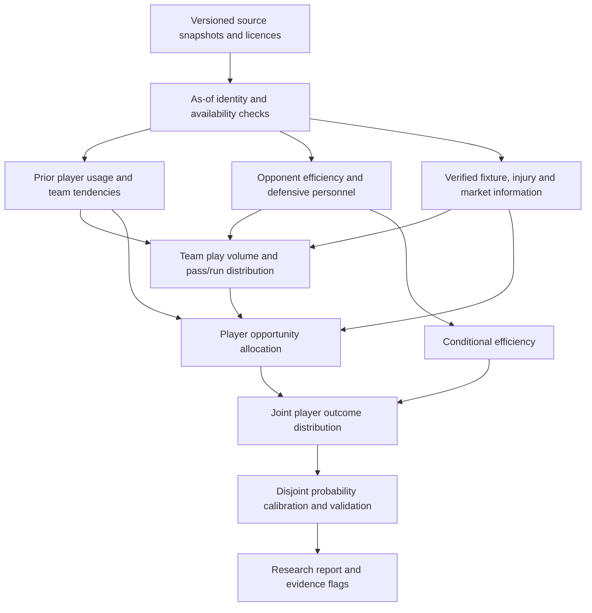

> Historical proposal: bounded C0–C2 implementation was subsequently approved.
> See `STAGE1C_C0_C2_PROTOCOL.md` and `STAGE1C_C0_C2_RESULTS.md` for its
> implementation and measured results. C3–C6 remain unapproved proposals.

# Stage 1C proposal: fixture-specific player forecasting

**Status: architecture and priorities for review only. No Stage 1C implementation
has started.** No new feature pipeline, model, forecast, capture schedule, paid
provider, dashboard deployment or production setting is authorised by this plan.

## 1. Approved merge and production boundary

PR #4 merged as `bcb9df3ca45055ace7e7cde75cd3a9170686f1a6`, with expected parents
`15a4028` and reviewed head `127f580`. Both final-head CI jobs passed. Main's
post-merge checks also passed: [Actions run 43512214119](https://github.com/coverend401/NFL-player-props-model/actions/runs/43512214119).
Before merging, the branch was current, main was unchanged, there were no active
conflicting jobs, and the legacy updater was still manually disabled.

Production source files, pipelines, configuration, requirements/lock, data/models,
release candidates and active pointer are byte-identical before/after the merge.
Active Stage 1A release: **`stage1a-20261113-py314-arrow24-r2`**. Local post-merge
integrity, all saved production forecasts and app smoke pass: nine models,
780 slate rows, 18 Top Picks. Python 3.14 / Arrow 24 remain unchanged. No database,
Supabase, authentication or bankroll settings were accessed or changed.

Live root and health endpoints respond HTTP 303 to the existing authentication
service. This confirms the service responds and the gate remains in place, **not**
that the authenticated app has been visually verified. An authenticated owner
check remains necessary; no credentials or authentication removal are requested.

## 2. Proposed outcome and first approval scope

The research model should forecast opportunities and efficiency for the actual
upcoming opponent, explain which observed inputs changed its forecast, and
propagate uncertainty into probabilities. It must learn matchup effects from
historical data rather than apply subjective boosts or treat defensive rankings
as established player-specific advantages.

**Recommend first approving C0–C2 below:** data/timestamp contracts, opponent
strength and team play-volume modelling, with existing usage features as controls.
Test all nine existing markets; make passing-yard accuracy the first primary
endpoint. This offers a useful, mostly public-data foundation before committing
to coverage charts, injury redistribution or a large game simulator. C3–C6 are
later gated increments, not permission to implement everything at once.

Keep frozen Stage 1B and Stage 1B.1 packages/artefacts intact. The final
**2026 week-11 onward** period remains sealed, with conservative cutoff
**2026-11-19T00:00:00Z**, including subsequent seasons. No final outcomes may be
used for feature selection, tuning, calibration, diagnostics or illustrative
examples. The first Stage 1C experiments use already inspected development data;
their improvements cannot be presented as fresh independent confirmation.

## 3. Data inventory: what is actually available

Evidence was inspected on 2026-11-13: local Parquet footers/schemas, installed
loader documentation, official source dictionaries/update schedules and GitHub
release asset metadata. No new outcome datasets were downloaded or materialised.
Machine-readable evidence is in `stage1c-source-inventory.json`. Asset existence
or a loader function does not establish completeness or historical availability.

| Source | Verified status | Appropriate use and missing evidence |
|---|---|---|
| Selected player-stat snapshot | 139,346 rows; the pipeline requests 2019–2026 | Box-score outcomes and prior ability/usage; retrospective revisions remain. Preserve true zeros versus missing observations. |
| Selected feature/participation panel | 185,912 rows; offensive share, targets, carries, air-yard/target shares, expected-opportunity/NGS fields, team totals and opponent aggregates are present | Recompute as-of features from eligible prior games. Column presence is not complete coverage or a genuine historical publication archive. The frozen benchmark has 49,034 development and 6,269 monitoring scored player-market rows. |
| Selected schedule snapshot | 7,548 rows, including home/away, rest, roof, spread/total and context timestamp | Fixture identity/rest can support context. It also contains scores, realised weather, retrospective QB/coach fields and closing lines: these are NOT automatically valid pregame covariates. A snapshot captured now does not timestamp old closing lines at T−60. |
| nflverse play-by-play | Installed loader; published Parquet assets listed for 1999–2026 | Acquire a versioned 2019–2025 development extract after approval, with optional earlier warm-up. Build team volume, neutral tendencies, efficiency, sacks, scrambles, target depth, game-state and pace summaries. Historical revisions/publication times need explicit tiering. |
| PFR offensive/defensive snap counts | Installed loader advertises 2012 onward; offensive participation already used in the selected panel | Audit player/team/game mapping and coverage before using defender units or teammate shares. Updates depend on upstream PFR availability; not every source shares the eight-hour completion proxy. |
| FTN public charting | Published assets 2022–2026; dictionary includes box count, blitzers/pass rushers, motion, play-action, RPO, screens and `date_pulled` | Candidate scheme proxies after their actual release. Coverage, season coding changes, attribution/licence and historical version retention need audit. These fields do NOT by themselves supply comprehensive man/zone coverage, routes-run totals or shadow assignments. |
| Detailed play participation / coverage | Assets 2016–2025; dictionary lists personnel, player IDs, primary receiver route, pressure and man/zone/coverage types | **Official guidance: 2023+ FTN participation is released only after all postseason games. No 2026 participation asset was listed.** Never treat 2023–25 game-dated records as available during those seasons. Prior completed-season summaries may be usable after verified publication, with staleness and staff-change uncertainty. Timely current-season updates need another authorised source. |
| Depth charts | Loader exists; official guidance says 2025+ snapshots append ISO timestamps rather than week labels | Audit snapshot timestamp semantics and retained history, then join at/before each decision. Older weekly charts may not establish a T−60 publication time. Current charts must never be backfilled into past weeks. |
| Injury reports | Published assets 2009–2026; dictionary has practice/report status and `date_modified` | Audit whether original updates are retained versus overwritten latest statuses. A modified timestamp alone is not a complete practice/inactive history. Verified announcement/receipt times and inactive/roster snapshots are required for strict injury replay. |
| Player IDs/rosters/transactions | Installed loaders and existing ID mappings | Build effective-dated team/position/roster membership; current roster is not historical roster. Transfers, rookies, returning players and failed joins need coverage accounting. |
| Routes, alignments and assignments | Full player routes-run, slot/wide alignment, individual coverage assignments and reliable live man/zone histories are NOT in the selected snapshot | Primary targeted route is not routes run by every receiver. Require a verified timely feed, possibly licensed, or omit these features. Snaps are not renamed as routes. No provider is selected/configured by this plan. |
| Bookmaker game/prop lines and prices | No licensed provider; no authenticated historical prop-price archive | Timestamped spread/total and both-side prop quotes are needed for market-aware forecasting/EV. Historical schedule closing lines lack the required decision-time evidence. Keep a market-free engine viable. No genuine ROI/backtest until evidence and settlement rules exist. |

The old `build_game_context` comment that closing lines are known before kickoff
is insufficient for a forecast issued **one hour earlier**. Stage 1C must not copy
that assumption. Similarly, expected-opportunity/EP/CPOE/NGS derived fields can
be revised or use later-trained upstream models. Audit model vintage; start with
observable rates/counts, or fit expected-value transforms within training folds.

## 4. Information architecture and chronology

Proposed research flow (these modules do not exist yet):

Initial horizon: **T−60 minutes before kickoff**, matching the existing research
framework. A Friday/Tuesday forecast and a T−60 forecast are separate products;
Sunday's final reports/lines cannot be used to evaluate a Friday forecast. Later
horizons require separate capture/validation, not a relabelled timestamp.

Each record should retain source/event ID, player/team identity, event time,
provider publication/update time, actual capture time, effective interval, revision
ID, hash and licence. Sources become usable only under a documented as-of policy.
A current retrieval cannot be backdated. Keep two explicit evidence tiers:

- **Retrospective research:** revised historical public statistics, with stated
  completion/publication proxies and sensitivity analysis; never called fully
  authenticated historical forecasts.
- **Verified as-of:** immutable contemporaneous snapshots or verifiable historical
  source versions published before the decision. New live/injury/market claims
  require this tier.

Retain the existing completed-game and eight-hour minimum safeguards where used;
new sources also need their own release-latency/availability checks. Completion
is not publication. Unknown timing cannot become "known" because a row carries
a game date. Never use a post-season participation table in an in-season feature
state. Lagging by one game alone does not solve delayed publication.

Timestamped defensive and player states include every eligible available game
before the cutoff, including genuine zero-opportunity participation. Never use
actual upcoming snaps, attempts, targets, roster outcome, score path, injury exit
or final roof/weather as pregame knowledge. Missing sources remain unknown, with
recorded fallback/staleness flags. Imputation/encoding/shrinkage is learned only
inside training folds. No feature-completeness filtering to improve headline scores.

## 5. Proposed model components and tests

### C0 — Data contracts and reproducible fixture states (small/medium)

Audit coverage by season, team, position, horizon and publication lag. Define
play/stat accounting and IDs before model fitting. Preserve the frozen research
population; additions such as rookies require a separately reported expanded
population with pregame eligibility, not a silently changed benchmark.

Proposed tests: future/current-game mutation invariance; late publication; stale
injury/depth snapshot; post-season-only coverage; missing IDs; trades; byes;
season boundaries; corrected stats; postponed games; prior games not yet complete;
participation zeros versus missing; identical batch/historical/live as-of states.
No genuine zero is fabricated from a missing box score or missing chart.

### C1 — Opponent strength and weakness (medium)

Start with separate **opportunity allowed** and **efficiency allowed**:

- Pass attempts/completions, completion rate, passing yards per attempt/completion,
  sacks and explosive-pass rates; QB scramble/designed-rush tendencies separately.
- Rush volume, yards per carry and explosive-run rate, separating QB and RB roles.
- Targets/receptions and yards per target/catch allowed to RB/WR/TE; target-depth
  buckets only where sufficiently observed. Position allowed is not an inferred
  individual defensive-back assignment.

Use decayed prior observations with league/position partial pooling and effective
sample sizes. Adjust for the quality and tendencies of offences previously faced,
rather than ranking raw yards allowed. Fit regularised attack/defence effects only
on the prior training history; no full-season strength-of-schedule estimates or
rankings computed with later opponents. Early-season defences shrink toward
prior-season/league priors, with explicit coordinator/personnel change uncertainty.

Test in order: historical baseline → raw lagged opponent totals → per-opportunity
shrunk rates → opponent-adjusted rates. Keep point model/training recipe fixed for
this feature ablation. Assess whether purported defensive weakness predicts
residuals after controlling player ability, opportunity and opponent schedule.
Inspect passing-yard bias and year reversals, not just pooled MAE.

### C2 — Offensive volume, pace and game script (medium/large)

Forecast a distribution over team plays/drives using both teams' prior pace,
neutral-situation seconds per play, no-huddle rate, drives, possession and rest.
Estimate pass/dropback versus rush decisions conditional on down/distance/time
and score state using historical plays. Define neutral situations before fitting;
exclude penalties/no-plays/special teams consistently, while reconciling official
stat-counting exceptions such as spikes, kneels, sacks and scrambles.

Two separately evaluated branches:

1. **Market-free:** prior team/opponent tendencies, fixture/rest and learned
   strength estimates; integrate possible leading/trailing/close-game states.
2. **Market-aware:** add timestamp-verified spread/total at the SAME decision
   horizon. Normalise spread signs with hand-worked tests; derive implied points
   only after source semantics are verified. Compare against market-free on the
   exact same quote-covered cohort and report missing coverage.

Never use the realised target-game score path to label a pregame scenario as
known. A detailed simulator would generate plausible paths; the first version can
be a simpler pregame volume/mixture model. Avoid arbitrary "trailing = 10% boost"
rules and double-counting a spread effect through multiple manual adjustments.

Evaluate team play counts, dropbacks/official attempts, rush counts, pass-share
proper scores and player-market MAE/proper scores. If team volume improves but
player forecasts do not, do not promote the feature family. Historical closing
lines may be described separately as an unavailable-information diagnostic; they
cannot supply a claimed T−60 gain or executable betting result.

### C3 — Role and opportunity allocation (medium/large)

Forecast offensive share, carry share, target share and QB participation from
prior availability, workload, competition and recent change. Use historical rates
with shrinkage and uncertainty, not simply extrapolate a last-game spike. Include
an "other/unassigned" category so counts are not forced onto the evaluated players.

Where verified routes exist: model routes per team dropback, targets per route and
catch efficiency; otherwise use labelled snap/target proxies. Do not derive routes
from targets. A simple regularised share model is the first benchmark; compare
Dirichlet-multinomial/logistic-normal allocation only if data justify it.

Allocate opportunities jointly so teammates compete for a finite pool. Keep
established, returning, short-history and traded-player cohorts visible. Unknown
history uses a trained hierarchical fallback, not automatic exclusion. Audit
candidate/participation coverage separately from conditional forecast accuracy.

Tests: opportunity MAE/deviance/calibration; conservation with unassigned shares;
zero-opportunity calibration; teammate and role-change cohorts; improvement in
downstream passing, rushing and receiving markets beyond volume/defence controls.

### C4 — Scheme and defensive personnel (large; source-gated)

Use timely prior box/blitz/pass-rush/personnel frequencies and interaction with
QB sack/scramble rates, receiver depth/role and protection tendencies. Broad
regularised interactions come before high-dimensional player-versus-coverage
fits. Defensive snap share is not an independently validated player-quality grade.

Man/zone, coverage shells, slot/wide matchups, shadow assignments and routes-run
require correct semantic definitions and timely coverage. Public post-season FTN
participation can support a stale prior-season prior once published, or a clearly
labelled unavailable-in-season exploratory study. It cannot masquerade as a live
current-season feed. A timely licensed source would require separate approval.

Train charting models only where source history exists. A 2022-start source cannot
magically supply 2019 training or the original 2022 fold. Compare against the frozen
baseline on identical later-year/covered subsets, with a full-population fallback;
do not attribute easier subset selection to scheme intelligence. Test source-era
changes, coding breaks, stale coaches, sparse coverage and held-out interactions.

### C5 — Injuries and teammate opportunity redistribution (large; source-gated)

Use only verified pre-decision reports/inactives, effective-dated roster/depth
snapshots and available workload history. Model uncertain participation/limited
usage as scenarios; unknown or questionable does not mean definitely out.
Condition on injuries to QB, skill players, offensive line and defensive units
where the data support it. Model quality of replacements and shared team impact,
not just subtract a starter's average from a position total.

Learn **predictive associations** between prior announced absences and role/share
changes with partial pooling across comparable roles, controlling team tendency,
other absences and matchup. An injured starter's entire workload is not awarded
to the next depth-chart name: team volume, formations and several teammates may
change. Opportunity conservation and residual share/uncertainty are required.
Historical contrasts are confounded, not proof of a causal injury effect.

Evaluate announced absence/return cohorts using announcements that precede the
same horizon. Match baseline cohorts, and audit missing announcements. Never use
final inactive lists, actual early exits or season-ending labels retrospectively
as earlier knowledge. If strict injury history is unavailable, keep this component
prospective-only; do not fill it using eventual participation outcomes.

### C6 — Joint outcomes, calibrated prices and understandable reports (large)

Ultimate research architecture: draw shared game/availability states, team volume,
player opportunities and conditional efficiency. Integrate the distributions;
E[opportunities] × E[efficiency] alone misses dependence and mixtures.

Reconcile official accounting: QB completions <= pass attempts; receivers' catches
come from simulated completed passes, with other/unassigned players represented;
sacks/scrambles are not official pass attempts; QB kneels count in the appropriate
rush markets; negative yardage remains possible. Passing yards must not subtract
team sack yards. Handle known official-stat/lateral exceptions explicitly. Do not
force every carry/target onto the nine-market eligible population.

Compare this structured model with a simpler direct contextual regression using
the same information. Complexity must earn a measured gain. Refit probability and
interval calibration for the NEW point/volume model using disjoint predictions;
old calibration is not automatically transferable. Keep monotone CDFs, coherent
Over/Under/push partitions and tested tails. Separate predictive dispersion,
parameter/model uncertainty and Monte Carlo error. Recheck interval sharpness,
conditional coverage and consistency with the pricing distribution.

Participation, actual sportsbook action and a zero outcome are distinct. Quotes
need reviewed market/book-specific action, push and void rules. Forecast both
conditional-on-action outcomes and action uncertainty where supported; a void
returns stakes, not a loss or an invented zero. The current research backtester
only supports its documented action rule; other rule types need separately tested
support before any genuine return calculation. No bankroll/ledger changes are
part of this architecture proposal.

A later research report should show: cutoff/source age, projected opportunities,
point/interval/probabilities, shrunk opponent effects, injury scenario weights,
missing-data warnings, model version, cohort sample sizes and numerical sensitivity
versus the frozen baseline. These are model explanations, not proven causal claims.
No invented confidence score or claim of a guaranteed matchup advantage. Actual
bookmaker prices/EV remain separate from hypothetical pricing probes.

## 6. Chronological evaluation and promotion gates

- **Comparators:** frozen Stage 1B.1 and Stage 1B historical bundles, naive career
  mean and simple recent/volume-share baselines. Never use production's November
  2026 trained pickles to predict earlier seasons. Stage 1A is a compatibility
  guard; the old normal-rule replay is not a reconstruction of historical live bets.
- **Outer periods:** preserve 2022–25 as development and 2026 weeks 1–10 as already
  viewed monitoring. Preserve annual rolling origins initially. Feature states can
  update after available games while parameters remain frozen for each outer fold.
- **Inner selection:** preserve the registered point train/selection/refit chronology
  and Stage 1B.1 prior-season distribution weeks 1–6, calibration 7–10, method
  selection 11–18. Preprocessing/ratings/embeddings/shrinkage/feature windows are fit
  inside those boundaries. Expanding opponent ratings must not be fit on a whole
  validation/test season before its games are predicted.
- **Weekly retraining:** evaluate later as a separate controlled experiment with
  rolling-origin out-of-fold residuals and calibration. Do not simultaneously add
  features and change the update policy, then attribute the gain to matchup data.
- **Ablations:** predeclare feature families/candidate budgets, add one family at a
  time, then test selected combinations. Freeze candidate definitions before each
  run, retain failed experiments and rerun both contextual and baseline forecasts
  on identical row IDs. No test-year method selection, silent cohort reduction or
  headline gains driven only by hypothetical tail thresholds.
- **Scores:** MAE/RMSE/bias for all nine markets plus intermediate volume/share
  diagnostics; Brier/log loss and probability-band reliability; 90% interval score,
  coverage and width. Report season, QB/RB/WR/TE, returning/history/availability
  cohorts, sample sizes, zeros, unknowns and source coverage.
- **Uncertainty:** paired game/week-aware bootstrap, with longer-block and
  leave-season-out sensitivity. Retain within-game/team dependence. Existing
  four-week conditional bands are exploratory; consider full pipeline refits where
  affordable. Cap multiple comparisons and label exploratory subgroup findings.
- **Proposed practical research gate, to register before fitting:** at least 1%
  primary point-MAE gain or .005 absolute log-loss gain, with a paired upper
  difference below zero for the claimed primary metric; no material Brier/bias/
  cohort regressions; better interval score without sacrificing acceptable coverage.
  Define market-specific coverage/cohort tolerances and minimum sample sizes in the
  approved protocol. These are proposed review gates, not promised improvements
  or permission to mine already viewed data until a threshold is crossed.
- **Independent evidence:** one separately approved, frozen final evaluation only.
  Do not open/repeat the sealed period to fix regressions. Prospective source/model
  snapshots may be captured after approval without inspecting final outcomes;
  evaluation access remains disabled until separately authorised. If the final test
  later informs tuning, a new future untouched period is necessary.
- **Betting:** proper scores at hypothetical lines remain forecast evaluation.
  Genuine price/return tests require authentic pre-decision quotes, frozen forecasts,
  price availability, margin, settlement/action rules, pushes, voids and stake
  accounting. No provider, quotes or genuine ROI are assumed. Production deployment
  would require a separate market-by-market release, new coordinated artefacts and
  explicit approval; it is never an automatic consequence of research merging.

## 7. Priorities, dependencies and effort

Indicative engineering/research effort, not a delivery or performance guarantee.
Coverage/licensing/publication-history blockers can add substantially more time.

| Order | Increment | Estimated effort | Dependency | Benefit to test |
|---|---|---|---|---|
| 1 | C0 contracts, source coverage and predeclared protocol | 2–4 working days | Approval of this plan; development-only data | Prevent timing/identity/selection errors before richer features |
| 2 | C1 shrunk opponent efficiency and schedule adjustment | 3–6 days | C0, player/team stats; PBP where needed | Better matchup signal beyond raw yards allowed |
| 3 | C2 team volume/pace and market-free game script | 5–10 days | C0–C1 and development PBP | Better passing/rushing opportunity forecasts |
| 4 | C3 role/share allocation and uncertainty | 5–10 days | C2, valid prior snap/target/carry history | Teammate-consistent player opportunities and role changes |
| 5 | C4 timely scheme/personnel additions | 5–10+ days | Verified feed coverage/latency; possible separate licence | Incremental efficiency/role interactions, not richer descriptions alone |
| 6 | C5 injury/availability redistribution | 7–15+ days | Proven announcement/roster snapshots and C3 | Robust absence/return forecasts with explicit uncertainty |
| 7 | C6 joint distribution/calibration/research reporting | 10–20 days | Useful earlier components and sufficient samples | Coherent cross-market probabilities/intervals; tested tail and scenario risk |

Priorities 5–6 can be reordered after the data audit: trustworthy injury information
may provide more value than detailed scheme labels. Timely data collection requires
separate source/operational approval; no paid service or job is configured now.

## 8. Proposed code boundaries after approval

A new `stage1c/` research namespace would contain source contracts/as-of joins,
team/defence states, usage/availability, contextual or joint models and evaluation.
Versioned output would live under `experiments/stage1c/`, with source/input/runtime
hashes, protocol, coverage, folds, forecasts, metrics and failed-experiment records.
New tests would live in `tests/test_stage1c_*.py`. Those are proposed paths only;
none has been created. The exact existing dependency lock remains the starting point.

Do not edit frozen `stage1b/`, `stage1b1/`, their artefacts, production `app.py`,
pricing, database, settings or active release. Any future integration needs a
separate approved release. A later standalone dashboard proposal may visualise
fixture effects, but no new dashboard is hosted or activated here.

**Requested next decision:** review this architecture and approve a bounded C0–C2
research scope first, including whether verified historical spread/total data is
available. If not, proceed market-free after approval. Defer paid coverage/route/
odds services and production activation until their value and prerequisites are
clear. No numerical predictive benefit is claimed in advance.

## Sources reviewed

- [Official nflverse update/availability schedule](https://github.com/nflverse/nflreadr/blob/main/vignettes/articles/nflverse_data_schedule.Rmd)
  — particularly post-season-only participation, source-specific latency and 2025+
  depth-chart snapshot changes.
- [Participation loader and attribution](https://github.com/nflverse/nflreadr/blob/main/R/load_participation.R),
  [participation dictionary](https://github.com/nflverse/nflreadr/blob/main/data-raw/dictionary_participation.csv).
- [FTN charting dictionary](https://github.com/nflverse/nflreadr/blob/main/data-raw/dictionary_ftn_charting.csv),
  [injury dictionary](https://github.com/nflverse/nflreadr/blob/main/data-raw/dictionary_injuries.csv).
- Official published assets inspected via GitHub API:
  [PBP](https://github.com/nflverse/nflverse-data/releases/tag/pbp),
  [participation](https://github.com/nflverse/nflverse-data/releases/tag/pbp_participation),
  [FTN charting](https://github.com/nflverse/nflverse-data/releases/tag/ftn_charting),
  [injuries](https://github.com/nflverse/nflverse-data/releases/tag/injuries).
  File presence does not prove publication-time validity, completeness or licence
  suitability for the intended use.
- Existing `STAGE1B_AUDIT_RESEARCH.md`, `STAGE1B1_PROTOCOL.md` and
  `STAGE1B1_RESULTS.md` for scoring, calibration, conformal assumptions, historical
  data limitations and the accepted frozen baselines.
